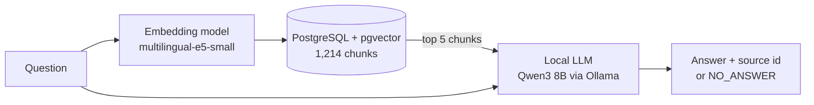

# grounded-qa

A local RAG (retrieval-augmented generation) system. I built it to answer one question: **does it know when it should not answer?**

Everything runs locally on my laptop: PostgreSQL with pgvector for search, a multilingual embedding model, and an 8B LLM through Ollama. I tested it on SQuAD 2.0 and logged every result to MLflow.

## What I found

- **Retrieval works well.** For 95.1% of the answerable questions, the right paragraph is in the top 5 results.
- **Answering is reasonable.** On answerable questions the system gets 56.7% exact match and 73.0% F1.
- **Abstaining is the weak point.** On unanswerable questions it abstains only 38.0% of the time. In the other 62% it gives an answer that the source does not support.
- **The overall score is 47.3%.** A system that always says "no answer" would get 50% on this sample, so the system is below this baseline.
- **A similarity threshold did not fix it.** The best threshold raised the overall score to 56.3%, but it also refused 56.7% of the answerable questions.
- **Most mistakes come from the LLM, not from the search.** In 49 of the 55 answers that missed exact match, the right paragraph was already in the context.

## Why search alone cannot catch unanswerable questions

SQuAD 2.0 has questions that look answerable from a paragraph, but are not. An example from the data:

> **Paragraph:** The Normans gave their name to Normandy in the **10th and 11th centuries**.
> **Question:** Who gave their name to Normandy in the **1000s and 1100s**?

The 10th and 11th centuries are the 900s and 1000s, so the paragraph does not answer the question. Still, the embedding model scores this question as more similar to the paragraph (0.906) than a real question about it (0.889). The LLM answers "The Normans".

On the whole dataset it looks the same: search finds the paragraph for unanswerable questions almost as often as for answerable ones (Recall@5: 91.3% vs 95.1%). Search measures whether the topic is similar, not whether the text supports an answer. So the decision to abstain has to come from a later step.

## How it works



| Part | What I used |
|---|---|
| Data | SQuAD 2.0 dev set: 11,873 questions, 1,204 paragraphs, 35 articles, 50.1% unanswerable |
| Chunking | One paragraph = one chunk. The 9 paragraphs over 380 words are split into 300-word windows with 50-word overlap (1,214 chunks) |
| Embeddings | `intfloat/multilingual-e5-small`, 384 dimensions, CPU |
| Vector store | PostgreSQL 16 + pgvector, cosine distance |
| LLM | Qwen3 8B through Ollama's OpenAI-compatible API, local GPU, temperature 0, fixed seed |
| Tracking | MLflow (parameters, metrics, result files per run) |
| Runtime | Docker Compose (database and Python app), Ollama runs on the host |

## Results

### Retrieval (all 11,873 questions)

Recall@k: how often the right paragraph is among the top k results.

| | @1 | @3 | @5 | @10 |
|---|---|---|---|---|
| Answerable | 78.9% | 91.8% | **95.1%** | 97.5% |
| Unanswerable | 72.2% | 86.9% | 91.3% | 95.4% |

Searching for all 11,873 questions took about 21 seconds (under 2 ms per question).

### End-to-end (300 questions: 150 answerable, 150 unanswerable)

I scored it the SQuAD 2.0 way: an answerable question is correct if the answer is an exact match, an unanswerable one is correct if the system abstains. In the original SQuAD task the model gets the paragraph. Here it has to find it first among 1,214 chunks, so these numbers are not comparable to the SQuAD 2.0 leaderboard.

| Metric | Value |
|---|---|
| Answerable: exact match | 56.7% |
| Answerable: F1 | 73.0% |
| Answerable: wrongly abstained | 6.7% |
| Unanswerable: correctly abstained | 38.0% |
| **Overall score** | **47.3%** |
| Baseline: always abstain | 50.0% |
| Average LLM time per answer | 0.76 s |

### Similarity threshold (abstain if the top score is below the threshold)

| Threshold | Answerable EM | Wrongly abstained | Unanswerable abstained | Overall |
|---|---|---|---|---|
| none | 56.7% | 6.7% | 38.0% | 47.3% |
| 0.83 | 49.3% | 18.7% | 50.0% | 49.7% |
| 0.85 | 38.0% | 34.0% | 65.3% | 51.7% |
| **0.87** | 24.0% | 56.7% | 88.7% | **56.3%** |
| 0.89 | 10.0% | 83.3% | 96.7% | 53.3% |

The top scores of the two groups overlap almost completely (mean 0.864 vs 0.849), so any threshold throws out answerable and unanswerable questions at about the same rate. I also tuned the threshold on the same 300 questions I evaluated it on, so these numbers are optimistic.

### Error analysis

- **Wrong answers are mostly LLM errors:** 49 of the 55 answers that missed exact match had the right paragraph in the context.
- **Unanswerable questions answered anyway** look like the Normandy example: a name, a date or the word order is changed, and the model follows the sentence instead of checking the detail. For example *"When did Richard II flee to Normandy?"* → "1013", but the paragraph is about someone else.
- **Exact match is stricter than it should be.** Some answers are right but too long ("The opposing party in the Runyon case was McCrary." vs "McCrary"), and some gold answers contain Wikipedia artifacts ("planning,[citation needed] design, and financing").

## Decisions I made

I tried to measure these instead of guessing:

- **5 chunks per question:** Recall@10 is only 2.4 points better than Recall@5, so it wasn't worth twice the context.
- **No vector index:** a full scan over 1,214 vectors takes 2.7 ms. With around a million chunks I would add an HNSW index.
- **The e5 `query:` prefix:** the model card says to use it. On this data it changed Recall by at most 0.9 points, almost always upward, so I kept it.
- **Thinking mode off:** with thinking on, Qwen3 used about 200 tokens and 4 seconds for a one-sentence answer. Without it: 34 tokens and under 1 second.
- **Local models:** no data leaves the machine, and the LLM server is not exposed on the network.

## What I learned

- Good retrieval numbers don't mean the system is reliable. Recall@5 was 95%, but the system still answered most of the unanswerable questions.
- It's worth looking at the metric too, not only the score. Exact match marked some correct answers as wrong.
- Small decisions (thinking mode, k, the index) were cheap to measure, and the results were not always what I expected.

## Known limitations

- One chunk is 542 tokens, which is over the embedding model's 512-token limit, so its last sentence is not embedded. It affects one test question. Token-based chunking would fix this.
- SQuAD questions were written by people reading the paragraph, so they share many words with it. Search on real company documents would be harder.
- The end-to-end evaluation uses only 300 questions. GPU inference is not fully deterministic, so results can change a little between runs.
- I tried a Hungarian question: search found the right English paragraph, but the 8B model answered off-topic and in English. For Hungarian it would need Hungarian prompts and test questions.

## Running it

You need Docker Desktop and [Ollama](https://ollama.com) with `ollama pull qwen3:8b`.

```bash
cp .env.example .env
docker compose up -d --build

docker compose exec app python src/grounded_qa/check_db.py        # enable pgvector
docker compose exec app python src/grounded_qa/build_corpus.py    # corpus, chunks, questions
docker compose exec app python src/grounded_qa/embed_chunks.py    # embeddings (~40 s on CPU)
docker compose exec app python src/grounded_qa/load_db.py         # load into pgvector
docker compose exec app python src/grounded_qa/eval_retrieval.py  # Recall@k
docker compose exec app python src/grounded_qa/eval_rag.py        # end-to-end, ~5 min
docker compose exec app python src/grounded_qa/analyze_rag.py     # threshold + error analysis
```

MLflow UI:

```bash
docker compose exec app mlflow ui --backend-store-uri sqlite:///mlflow.db --host 0.0.0.0 --port 5000
```

Then open http://localhost:5000 and switch to the **Model training** view.

## Project structure

```
src/grounded_qa/
  check_db.py        enable pgvector, check the connection
  build_corpus.py    SQuAD 2.0 → passages, chunks, questions
  embed_chunks.py    token counts and embeddings
  load_db.py         chunks + vectors into PostgreSQL
  search.py          vector search and query plan
  eval_retrieval.py  Recall@k, logged to MLflow
  rag.py             retrieve → prompt → LLM → parse
  metrics.py         SQuAD exact match and F1
  eval_rag.py        end-to-end evaluation, logged to MLflow
  analyze_rag.py     threshold sweep and error analysis
```

## What I want to do next

- [ ] A verification step with LangGraph: check whether the retrieved text really supports the answer before replying
- [ ] FastAPI endpoint and MCP server
- [ ] pytest tests and GitHub Actions CI
- [ ] Stricter prompt for shorter answers
- [ ] Token-based chunking
- [ ] Compare e5-small with e5-base
- [ ] Notebook with score distributions and the threshold trade-off curve
- [ ] Hungarian evaluation set
